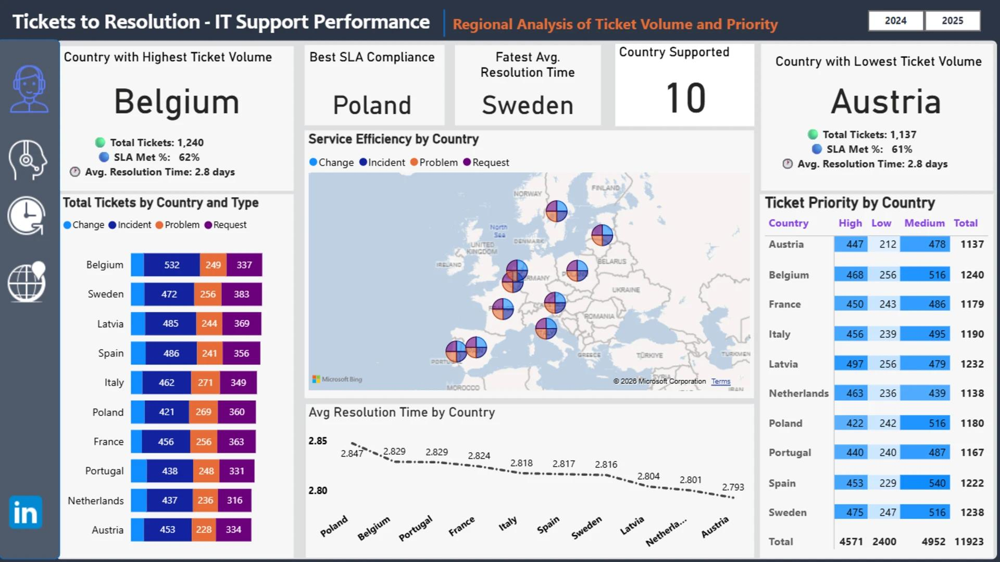
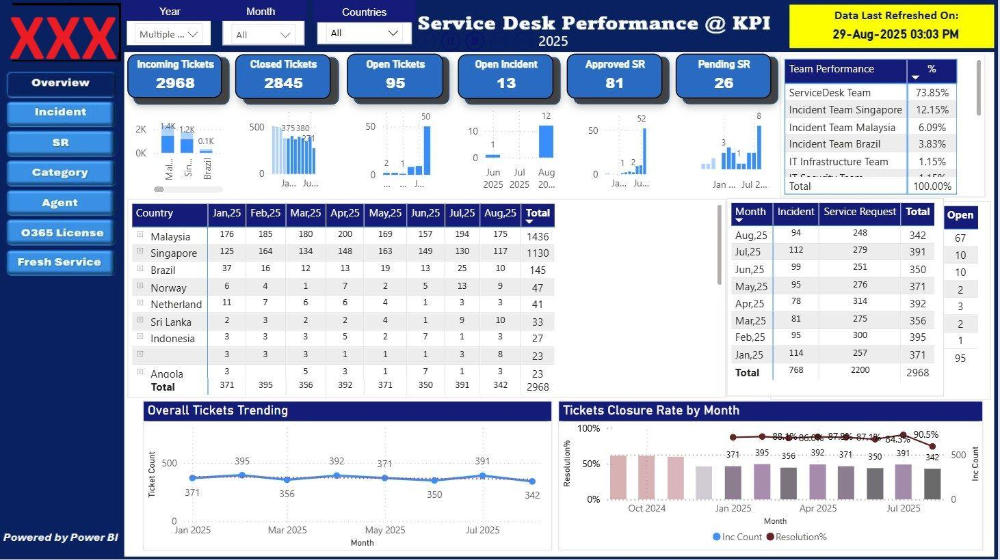
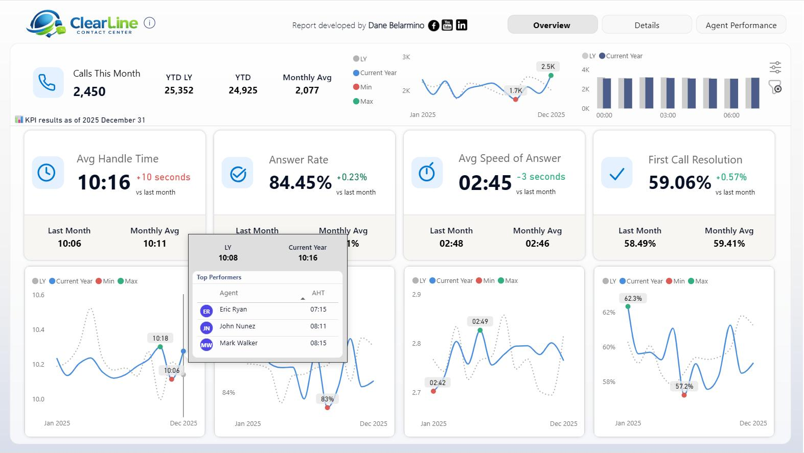

# Power BI Service Performance Dashboard

## 📌 Project Overview
This project focuses on analyzing service operations using Power BI to monitor service performance, pending calls, turnaround time (TAT), backlog ageing, and regional performance.

The objective is to convert service data into actionable insights that support better decision-making, improve SLA compliance, and identify areas requiring operational attention.

## 🎯 Business Objectives
- Monitor service call closure performance and TAT.
- Analyze pending service calls and backlog ageing.
- Compare performance across regions and service partners.
- Identify overdue calls and operational bottlenecks.
- Support data-driven decisions to improve service efficiency.

## 📊 Key Performance Indicators (KPIs)
- Total Service Calls
- Closed Calls
- Pending Calls
- TAT Compliance %
- Overdue Calls
- Backlog Ageing
- Regional Performance
- Service Partner Performance

## 🛠️ Tools & Technologies
- Microsoft Power BI
- Power Query for data transformation
- DAX for measures and calculations
- Data visualization and business reporting

## 📸 Dashboard Screenshots

### Regional Performance

### Pending Calls & Ageing

## 💡 Expected Business Value
- Improved visibility into service operations.
- Faster identification of ageing and overdue calls.
- Better monitoring of regional and service partner performance.
- More informed decisions to improve TAT and backlog management.

## 🔒 Data Privacy
Any publicly shared dataset or screenshot should use synthetic or anonymized data. Confidential customer details, service-order numbers, serial numbers, employee information, and company-sensitive information must not be published without authorization.

## 📸 Dashboard Screenshots

### Regional Performance

### Pending Calls & Ageing

### Daily Service Performance

## 👤 Author
**Murthy S N**

[LinkedIn](https://www.linkedin.com/in/murthysn)

